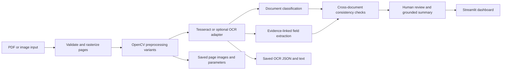
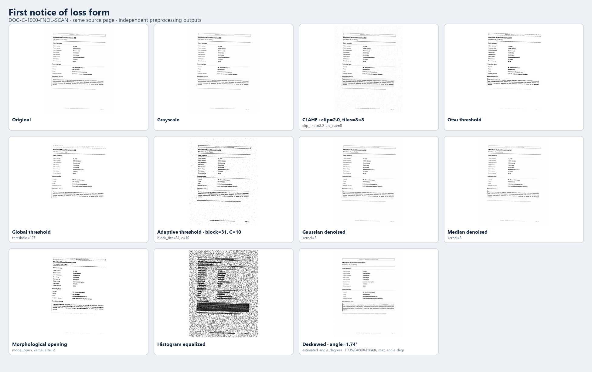
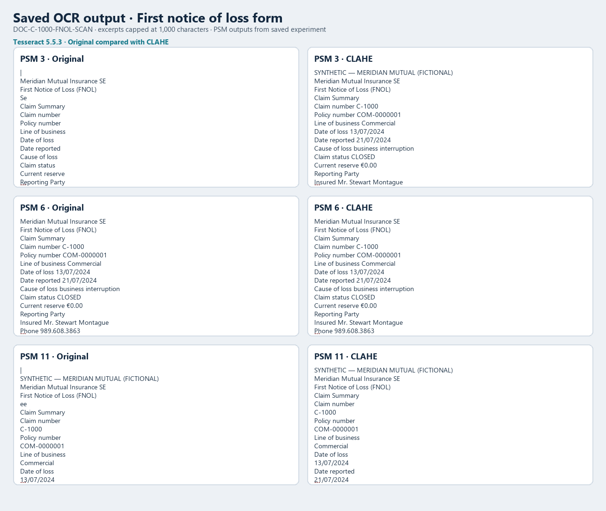
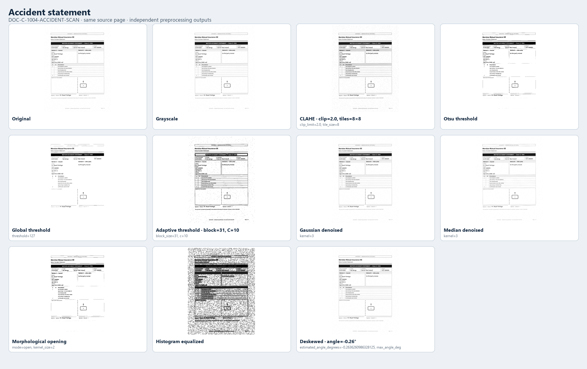
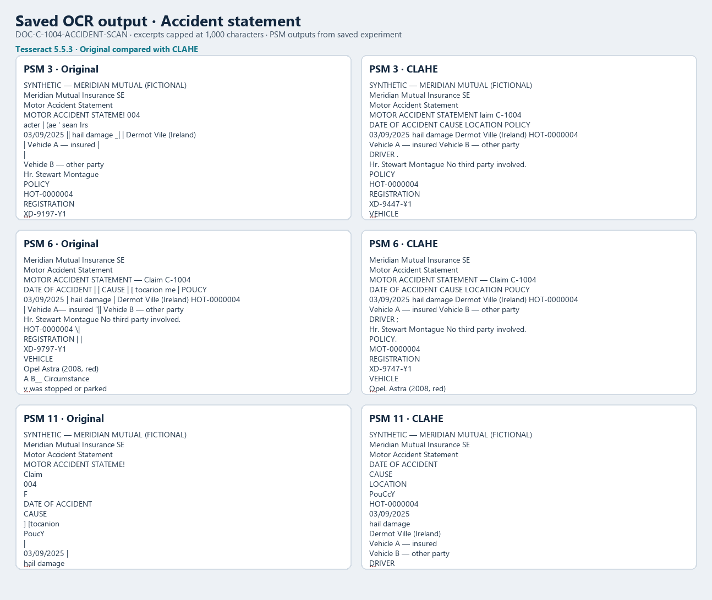
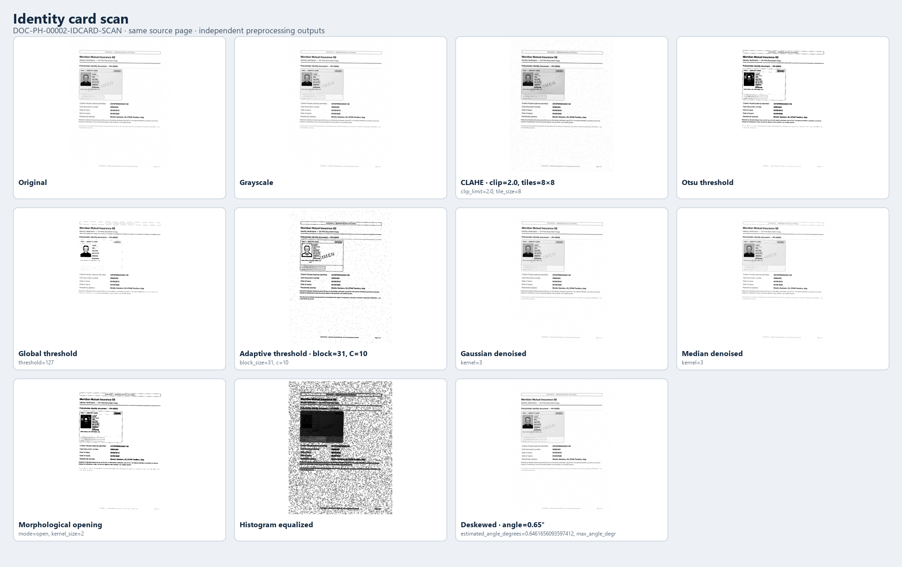
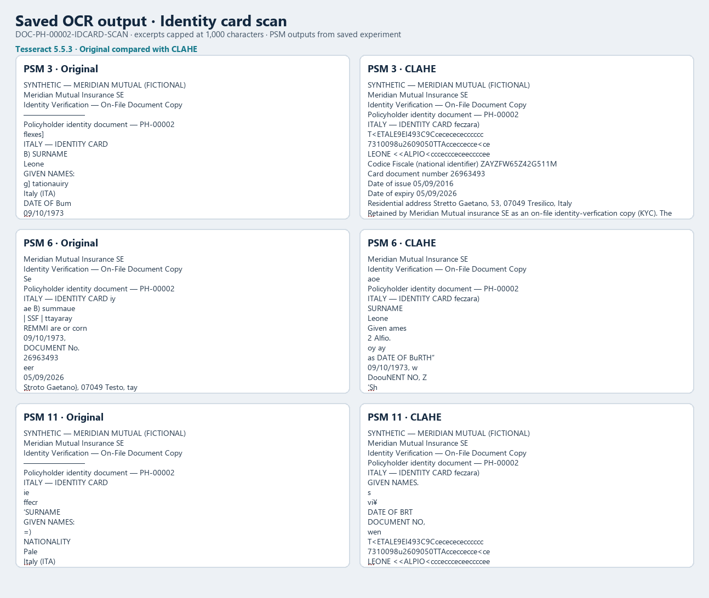

# Insurance Document Intelligence for Automated Policy and Claim Intake

A local academic prototype for document intake assistance. It combines digital image preprocessing, OCR, rule-based document classification and field extraction, evidence-linked cross-document checks, and a Streamlit review interface. It is a demonstration system: it does not approve or reject claims, and it is not deployed by an insurer.

## Problem statement and objectives

Policy and claim intake material may arrive as scans or images with uneven lighting, noise, skew, and varied layouts. The project explores a local workflow that can:

- Accept PDF and image uploads and convert pages for processing.
- Compare OCR across independent image-processing variants.
- Identify likely document type and extract candidate insurance fields with evidence.
- Flag cross-document inconsistencies for human review.
- Show limitations and measured results without treating OCR confidence as truth.

The objective is decision support for an academic demonstration. The objective is not automated underwriting or a production service.

## Dataset sources and composition

The local inventory covers 98 files: 88 records from the copied Strata sample manifest and 10 Gritworks PDFs. The Strata sample is **synthetic** and contains 5 claims, 5 policies, and 6 policyholders. It is not representative real-world insurance data and does not establish an insurer relationship.

| Source/content | Composition | Use in this project |
|---|---|---|
| Strata sample | 42 PDF, 34 JPG, 6 DOCX, 3 XLSX, 2 MD, 1 CSV; synthetic | Inventory plus exploratory OCR and field extraction on eligible scans |
| Gritworks sample | 10 PDFs with raster pages and selectable text; no corresponding labels supplied | Inventory only; not included in the OCR metric comparison |
| Eligible Strata document scans | 23 images; 19 have same-stem PDFs; 4 police-report images have no paired PDF | Tesseract experiment, all 23 OCR processed |
| Standalone photos | 11 evidence/face images | Excluded from document OCR |
| FUNSD | Separate general form-understanding benchmark | Prior supplementary OCR work only; it is not an insurance dataset and is not part of the insurance experiment |

Inventory artifacts are `outputs/insurance_dataset_inventory.csv` and `outputs/insurance_dataset_summary.json`. FUNSD evaluation uses its test split only and must be discussed separately. See [dataset notes](docs/datasets.md) for additional provenance and licensing context.

## System architecture and workflow

The Streamlit application is a local modular monolith. Core processing lives in reusable Python modules so the app, experiment scripts, and tests share the same implementation.



Main modules:

- `src/ingestion/loader.py`: validates inputs and loads PDF/image pages.
- `src/processing.py`: calls preprocessing and OCR, then records page and document outputs.
- `src/preprocessing/pipeline.py`: OpenCV operations and `build_variants()`.
- `src/ocr/engine.py`: OCR adapters; Tesseract is configured through `TESSERACT_CMD`.
- `src/classification/classifier.py`: explainable rule baseline and optional supervised classifier when labeled examples exist.
- `src/extraction/fields.py` and `src/extraction/insurance_fields.py`: candidate fields, evidence, and missing statuses.
- `src/validation/insurance.py` and `src/validation/rules.py`: consistency checks with review statuses; no claim disposition.
- `src/evaluation/metrics.py`: CER/WER and other metrics when suitable references exist.
- `app/main.py`: existing upload, image lab, OCR, extraction, validation, summary, and evaluation views.

Typical flow: upload → rasterize → generate independent variants → OCR each view → classify/extract candidates → compare related documents → display evidence and review flags.

## Image preprocessing techniques

The experiment compares the original image with ten independent views from `build_variants()`:

1. Grayscale conversion.
2. CLAHE (clip limit 2.0; 8×8 tile grid).
3. Otsu thresholding.
4. Global thresholding (threshold 127).
5. Adaptive Gaussian thresholding (block size 31; C=10).
6. Gaussian denoising (3×3 kernel).
7. Median denoising (3×3 kernel).
8. Morphological opening (2×2 rectangular kernel).
9. Histogram equalization.
10. Deskewed grayscale, with the estimated angle and rotation parameters recorded.

Each variant is derived independently from the page input. Thresholds and morphology can remove faint strokes, merge nearby glyphs, or amplify background artifacts. Deskew is not assumed to improve OCR. It is evaluated as another independent variant.

## OCR methodology and PSM configurations

The local experiment used Tesseract **5.5.3**. For each of the 23 eligible scan images, every available preprocessing variant was OCR’d under:

- **PSM 3**: automatic page segmentation.
- **PSM 6**: assume one uniform block of text.
- **PSM 11**: sparse text, find text in no particular order.

The same scan, variants, and ground-truth source were used for the three PSM comparisons. OCR text is saved for unmatched scans too, but no CER/WER is assigned where there is no reference. PSMs and preprocessing were compared on this sample; these results are descriptive and must not be used as an unbiased final estimate after selecting a configuration.

The reference for each paired scan is selectable text from its same-stem PDF, extracted with PyMuPDF in page order and `sort=True`. Scoring applies Unicode NFKC, casefolding, and whitespace collapse; punctuation and text are retained. PDF text has not been exhaustively checked against the rendered scan, so the transcription scores below are **provisional**. The audit found that changing PyMuPDF ordering (`sort=True` to `sort=False`) altered 10 of 19 normalized references, demonstrating order sensitivity. Neither ordering is treated as adjudicated ground truth.

## Classification, field extraction, and cross-document validation

Document classification uses an explainable rule-based baseline. An optional TF-IDF/logistic-regression path exists for a future labeled training/evaluation set; this local insurance sample was not used to train a classifier.

Insurance field extraction is a regular-expression baseline over OCR text. Candidate fields include claim/policy identifiers, insured name, dates, cause, claim status/decision, amounts, vehicle details, and identity number. Extracted values retain evidence and missing statuses. Confidence is uncalibrated. The experiment compares candidates against fields joined from the Strata synthetic `model.json` through manifest entity identifiers.

Cross-document checks compare repeated values to the synthetic metadata and each other. Outcomes include `VERIFIED`, `MISMATCHED`, `MISSING`, and `MANUAL_REVIEW_REQUIRED`. These are consistency flags only: a discrepancy may be due to OCR, reference content, or a true document disagreement. The app never determines coverage or claim eligibility.

## Evaluation metrics and results

### Metric definitions

- **CER** = character-level Levenshtein edit distance ÷ reference characters.
- **WER** = word-token Levenshtein edit distance ÷ reference words.
- **Macro CER/WER** = arithmetic mean of the per-document normalized scores; each document receives equal weight.
- **Micro CER/WER** = pooled edits divided by pooled reference characters/words; longer references receive more weight.
- **Precision, recall, F1** for fields use strict normalized exact-value matching. A nonempty wrong value is counted as FP and FN; a missing value is FN. The report also includes a diagnostic reference-supported subset.

### Verified arithmetic versus provisional reference validity

The audit independently recalculated all scores from saved predictions and references using a separate exact Levenshtein implementation. All **627/627 scored CER and WER values** matched the saved results. The denominators are 19 paired documents, 19,555 normalized characters, and 2,792 normalized words for each PSM/variant. There are 759 unique OCR records total; 132 rows from the four unmatched scans have no references and are excluded. There are no empty scored references or duplicate evaluation keys.

Those checks verify arithmetic and record integrity, **not** whether each PDF text reference faithfully matches its scan. Thus OCR comparison values are provisional despite the verified recomputation.

### Original versus CLAHE

The table gives macro and micro scores for the original image and CLAHE. Lower error is better for this sample comparison only.

| PSM | View | Macro CER | Macro WER | Micro CER | Micro WER |
|---:|---|---:|---:|---:|---:|
| 3 | Original | 0.306785 | 0.377461 | 0.304833 | 0.372851 |
| 3 | CLAHE | 0.177384 | 0.271460 | 0.178624 | 0.267550 |
| 6 | Original | 0.329215 | 0.421155 | 0.327896 | 0.416547 |
| 6 | CLAHE | 0.224573 | 0.328093 | 0.219126 | 0.323066 |
| 11 | Original | 0.287972 | 0.377817 | 0.286883 | 0.373567 |
| 11 | CLAHE | 0.142398 | 0.248395 | 0.142930 | 0.245344 |

CLAHE had lower CER on 18/19, 17/19, and 19/19 paired documents for PSM 3, 6, and 11 respectively; by WER it was lower on 18/19, 18/19, and 19/19. Individual regressions occurred. No statistical significance test was performed. This sample is synthetic, has no train/development/test split, and was not reserved as an independent hold-out set.

### Field extraction

| PSM | View | Exact matches / 124 | Precision | Recall | F1 |
|---:|---|---:|---:|---:|---:|
| 3 | Original | 100 | 0.9091 | 0.8065 | 0.8547 |
| 3 | CLAHE | 93 | 0.8611 | 0.7500 | 0.8017 |
| 6 | Original | 102 | 0.9107 | 0.8226 | 0.8644 |
| 6 | CLAHE | 100 | 0.8850 | 0.8065 | 0.8439 |
| 11 | Original | 98 | 0.8750 | 0.7903 | 0.8305 |
| 11 | CLAHE | 94 | 0.8468 | 0.7581 | 0.8000 |

These are exploratory strict comparisons against synthetic metadata. The audit classified the 24 PSM 3 Original unmatched values as 3 incorrect, 12 missing, 9 reference ambiguities, and 0 unavailable. The paired PDF text did not support every metadata value; the report therefore also provides reference-supported sensitivity metrics. Field extraction results are not interchangeable with OCR CER/WER.

## Visual comparisons

The figures use the shared `build_variants()` pipeline and saved OCR outputs. The OCR sheets show excerpts (not newly measured output); complete OCR text remains in the experiment JSON/text files. All example documents are from the synthetic Strata sample.

### First notice of loss





### Accident statement





### Identity card





## Limitations and future scope

- Synthetic, small corpus; no supplied hold-out split and no representation claim for real-world insurance data.
- PDF text references are not exhaustively aligned with scan images. Extracted reading order and whitespace joining can change CER/WER.
- Four police-report scans lack same-stem reference PDFs; they are OCR’d but unscored.
- Only 19 of 23 scans contribute OCR metrics. Documents share claim/policyholder entities and are not independent samples.
- Rule-based classification/extraction is brittle and confidence is not calibrated.
- PSM and preprocessing comparisons are descriptive; no statistical significance is claimed.
- No production readiness, insurer deployment, or coverage decision is claimed.

Future academic work should manually adjudicate scan-level transcripts and field applicability, establish document- and entity-level development/hold-out splits, freeze OCR/preprocessing choices before final scoring, add a suitably sized representative dataset with approved use, and study human review and privacy safeguards.

## Installation and execution (Windows PowerShell)

Run commands from the repository root. Python 3.12 is used in the supplied environment. Install the dependencies and ensure Tesseract OCR 5.5.3 is installed separately on Windows.

```powershell
py -3.12 -m venv .venv
.\.venv\Scripts\Activate.ps1
python -m pip install --upgrade pip
python -m pip install -r requirements.txt
# Optional OCR adapter dependencies if needed by the application:
python -m pip install -r requirements-ocr.txt
# Point to the local Tesseract executable if it is not on PATH:
$env:TESSERACT_CMD = 'C:\Program Files\Tesseract-OCR\tesseract.exe'
```

Run the app:

```powershell
streamlit run app/main.py
```

Reproduce the local insurance inventory, OCR experiment, and audit:

```powershell
python scripts/inspect_insurance_dataset.py
python scripts/run_insurance_ocr_experiment.py
# Audit the saved reference run used for this report:
python scripts/audit_insurance_experiment.py
```

Rebuild fields/validation from the saved OCR JSON without rerunning OCR:

```powershell
python scripts/run_insurance_ocr_experiment.py --output-dir outputs\insurance_experiments\run_20261110_235259 --rebuild-fields
```

Generate the static visual sheets included above:

```powershell
python scripts/generate_academic_visuals.py
```

Run the project tests:

```powershell
python -m pytest -q
```

The prior FUNSD work is a separate general form-understanding OCR benchmark. It is not insurance data and is not used in the insurance sample metrics. Its scripts and saved outputs remain separate from the insurance experiment artifacts.

## Academic submission documents

- [Final project report](docs/insurance_document_intelligence_final_report.md)
- [Presentation outline](docs/presentation_outline.md)
- [Technical viva preparation (54 questions)](docs/technical_viva_preparation.md)
- [Independent experimental audit outputs](outputs/insurance_experiments/audit_20261111_002848/audit_summary.md)
- [Dataset notes](docs/datasets.md)
- [Architecture](docs/architecture.md)

## Final submission package

Individually named, prefixed deliverables are organized under `submission/` in nine folders for the problem statement, state of the art, methodology, source code, data sources, USP and DIP visuals, results, references, and the four-page paper. Original source/data/results remain in their existing locations. Dataset binaries are not duplicated into the package. The PDF page count is checked by `scripts/build_ieee_paper.py`.

To rebuild the generated submission copies and paper from the repository root in Windows PowerShell:

```powershell
python scripts/build_ieee_paper.py
python scripts/prepare_submission.py
```

The package includes existing preprocessing/OCR visual comparison sheets and the report/audit sources. A saved file-backed screenshot set for all eight dashboard sections is not included: the app was launched and Overview was observed, but the available desktop browser capture returned an in-session image and did not expose a workspace save operation. Upload-dependent views also need a document in the live app session. Do not treat empty-state screens as evidence of document processing.

Run the application:

```powershell
streamlit run app/main.py
```
