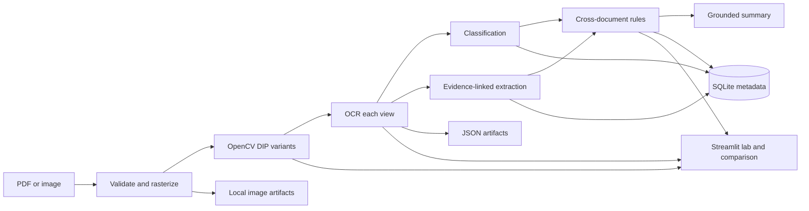
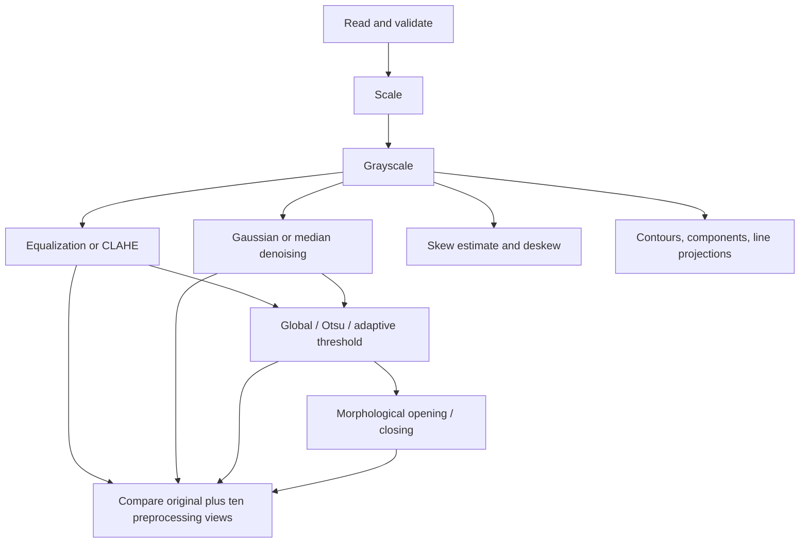

# Architecture and implementation plan

## Decisions

The initial version is a local modular monolith: Streamlit provides the demonstration UI; independent Python modules implement reusable operations; SQLite stores document/job metadata; JSON and image files store detailed results. A separate FastAPI service would add deployment complexity without improving this single-machine academic demo, so it is deferred behind stable module boundaries.

OpenCV/NumPy implement image processing. PyMuPDF rasterizes PDF pages. OCR is an adapter that prefers PaddleOCR when installed and falls back to Tesseract; both are optional. Classification begins with an explainable keyword/layout baseline and supports a TF-IDF/logistic-regression model if labeled training examples are supplied. LLM summarization is opt-in; deterministic summaries cite extracted evidence.

## Data flow

## DIP pipeline

## Module responsibilities

| Module | Responsibility and interface |
|---|---|
| `src/ingestion/loader.py` | Validate extensions/content; `load_pages(bytes, filename)` returns RGB page arrays. PDF order is preserved. |
| `src/preprocessing/pipeline.py` | Parameterized pure OpenCV operations and `build_variants(image)`; returns images plus operation parameters. |
| `src/ocr/engine.py` | Optional PaddleOCR/Tesseract adapter; returns page, text lines, boxes, confidence and status; compares every configured view. |
| `src/classification/classifier.py` | Explainable keyword baseline plus TF-IDF/logistic-regression fit/predict API for labeled text. |
| `src/extraction/fields.py` | Regex baseline per document type; every value carries page, source filename and matching OCR snippet; absent values are null. |
| `src/validation/rules.py` | Policy/claim/date/invoice checks scoped to a case ID; returns a status and source/evidence text. |
| `src/summarization/summary.py` | Evidence-cited deterministic summary, with optional structured LLM call and fallback. |
| `src/evaluation/metrics.py` | CER/WER, classification, entity, validation, PSNR/SSIM calculators; unavailable ground truth stays unavailable. |
| `src/processing.py` | Orchestrates pages and stores stage images, OCR JSON, field JSON, timing and errors. |
| `app/main.py` | Streamlit views only; calls the same modules used by tests and scripts. |

## Experimental design

The processing run records text for the original plus grayscale, histogram-equalized, CLAHE, global, Otsu, adaptive, Gaussian, median, morphological, and deskewed images. `scripts/run_ocr_experiment.py` joins saved OCR JSON to human page transcriptions and calculates method-wise CER/WER, including per-page best and worst cases against original. `scripts/train_classifier.py` and `scripts/evaluate_classifier.py` keep training and test documents in separate splits for a paired keyword-vs-TF-IDF/logistic-regression comparison. Entity and validation metrics are computed only where their ground-truth fields are provided. OCR confidence and character yield are descriptive diagnostics, not substitutes for ground truth. Synthetic examples demonstrate the flow but are not benchmark evidence.

## Phases and acceptance

1. Requirements and architecture: this document; local-first stack, optional external services.
2. Dataset groundwork: inspect-first registry and annotations, no silent large downloads, synthetic examples.
3. DIP: reusable functions record parameters and save intermediate images.
4. OCR: page-aware boxes/text/confidence and comparison of original plus the required variants, with additional histogram-equalization and Gaussian-denoising controls.
5. Classification: explainable baseline and optional supervised upgrade.
6. Extraction: values with evidence, source page and confidence; absent data remains null.
7. Validation: explicit evidence-backed statuses; no claim decision.
8. Summarization: grounded fallback plus optional API integration.
9. Dashboard: overview, upload, DIP lab, OCR, intelligence, validation, summary and evaluation.
10. Tests/evaluation: synthetic unit tests; document/page processing times; no invented benchmark outcomes.
11. Documentation and demonstration guide.

## Limitations

OCR varies with engine, language and scan quality. Rule classification/extraction are baselines. CER/WER/F1 require labeled ground truth; PSNR/SSIM require clean references. Dataset access and licensing must be checked before collection. Optional LLM summaries transmit selected extracted evidence to the configured provider. This system does not decide coverage or claim eligibility.

## Insurance sample experiment integration

`scripts/inspect_insurance_dataset.py` consumes the local Strata manifest and inventories the extracted Strata/Gritworks data without mutating historic evaluation artifacts. `scripts/run_insurance_ocr_experiment.py` calls the existing document pipeline for eligible Strata scan images, then runs controlled Tesseract PSM 3/6/11 comparisons on each independently generated preprocessing variant. It writes a new timestamped output directory and evaluates reference text only for scans with same-stem PDFs. Those text references remain provisional pending visual alignment review; unmatched records have no CER/WER. Rule-based field extraction and cross-document checks are exploratory and do not make claim decisions.
